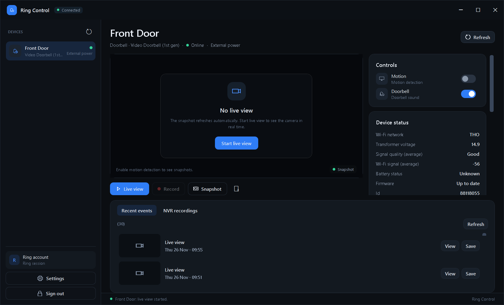
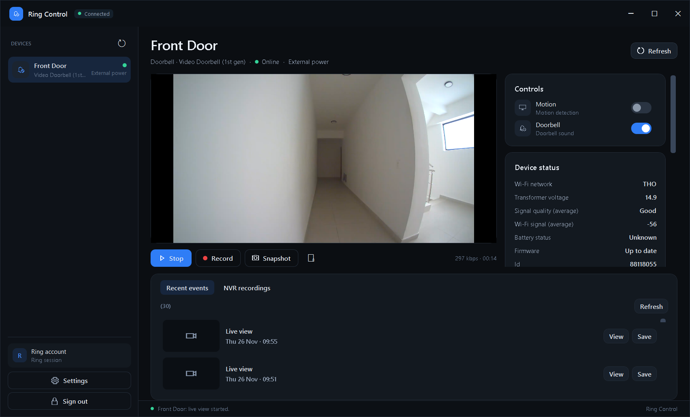
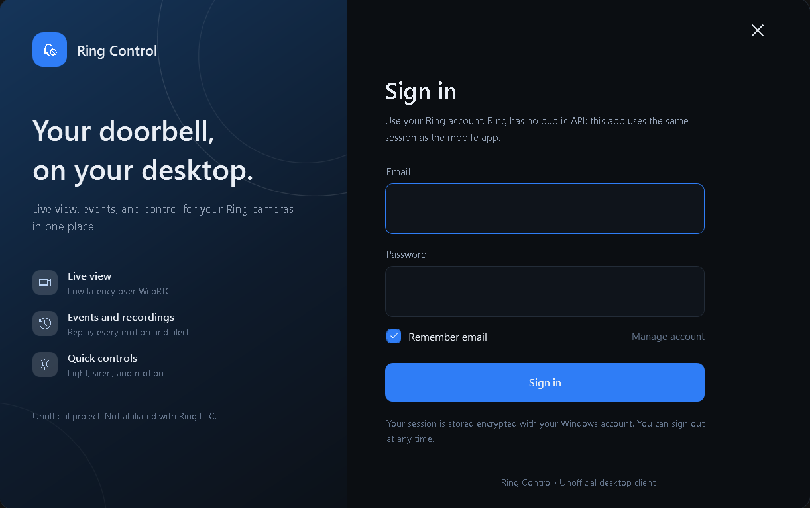

# RingControl

NVR and control panel for **Ring** cameras and doorbells, featuring:

- **Windows desktop app** (WPF, dark theme): device status, live view embedded in the main window, light, siren, chime, motion detection, manual recording, and **NVR mode**.
- **Headless CLI + daemon for Linux**: 24/7 or event-based recording, segment rotation, retention, and `systemd` service.
- **Shared engine** (`RingControl.Core`) that records H.264 directly to **fragmented MP4** without ffmpeg or native dependencies.

> ⚠️ **Notice**: Ring does not offer a public API. RingControl uses the same private API as the official app and projects like `ring-client-api` / `python-ring-doorbell`. Ring may change or block access at any time. Use only with your own account.

---

## Screenshots

| Desktop app | Live view |
| --- | --- |
|  |  |

| Sign in |
| --- |
|  |

---

## Features

| Area | Detail |
| --- | --- |
| Authentication | Ring OAuth with password, 2FA (SMS/TOTP), and refresh token |
| Security | Only the *refresh token* is stored: DPAPI on Windows, AES-256-GCM + `0600` key on Linux. Never the password |
| Video | WebRTC (SIPSorcery) → H.264 RTP → fragmented MP4, no re-encoding |
| NVR | `events`, `continuous`, and `both` modes, configurable segments, event clips, retention by days and disk quota |
| Storage | `<Videos>/RingControl/<camera>_<id>/<date>_<type>.mp4` + sidecar `.json` |
| GUI | Live view, snapshots, events, device controls, and recording |
| CLI | `login`, `devices`, `status`, `snapshot`, `record`, `clips`, `nvr run/status/stop/config` |
| Installation | Windows installer (GUI + CLI + NVR) and `install.sh` with `systemd` unit for Linux x64/arm64 |

---

## Requirements

- **Windows 10/11 x64**. The installer is self-contained: no .NET installation required.
- **Linux x64 or arm64** with `systemd`. The binary is self-contained.
- A Ring account with at least one camera or doorbell, and phone access for 2FA.
- The camera must allow **live view** (not disabled in the Ring app).

---

## Windows Installation

1. Download `RingControlSetup-1.0.1.exe` from the [latest release](https://github.com/leosep/Ring/releases/latest).
2. Run it and choose the folder (default `%LOCALAPPDATA%\Programs\RingControl`), shortcuts, and whether to start the NVR on login.
3. Click **Install**. No administrator privileges required.
4. Open RingControl and sign in with your Ring account (2FA code included).

Silent installation (e.g., for deployments):

```powershell
.\RingControlSetup-1.0.1.exe /S --autostart --no-launch
```

Installer options:

| Option | Effect |
| --- | --- |
| `/S`, `--silent` | No UI |
| `--dir <path>` | Installation folder |
| `--no-desktop` | No desktop shortcut |
| `--no-startmenu` | No Start Menu entry |
| `--no-path` | Don't add `ringcontrol` to user PATH |
| `--autostart` | Start NVR on login |
| `--no-launch` | Don't open app on finish |
| `--uninstall` | Uninstall |
| `--purge` | On uninstall, also delete config and session |

A portable version `RingControl-1.0.1-win-x64.zip` is also generated, which doesn't write to the registry.

Uninstall: **Settings → Apps → RingControl**, or

```powershell
"%LOCALAPPDATA%\Programs\RingControl\RingControlSetup.exe" --uninstall
```

---

## Linux Installation (CLI + NVR)

### 1. Build the binary

You need the .NET 9 SDK only for building:

```bash
./deploy/linux/build.sh            # detects x64/arm64
# or
./deploy/linux/build.sh arm64
```

Generates `dist/linux-<arch>/ringcontrol` (self-contained, single file).

### 2. Install

```bash
# System service (recommended), runs as your user:
sudo ./deploy/linux/install.sh

# User service, no root:
./deploy/linux/install.sh --user

# Custom recordings folder:
sudo ./deploy/linux/install.sh --recordings /mnt/recordings
```

The installer:

- copies the binary to `/opt/ringcontrol` (or `~/.local/opt/ringcontrol`),
- creates the `ringcontrol` command,
- prepares `~/.config/ringcontrol/nvr.json`,
- prompts for Ring login if no saved session exists,
- installs and enables `ringcontrol-nvr.service` with `Restart=always`.

### 3. Verify

```bash
ringcontrol --version
ringcontrol nvr status
sudo systemctl status ringcontrol-nvr
sudo journalctl -u ringcontrol-nvr -f
```

If you change configuration:

```bash
nano ~/.config/ringcontrol/nvr.json
sudo systemctl restart ringcontrol-nvr
```

### 4. Uninstall

```bash
sudo ./deploy/linux/uninstall.sh             # keeps recordings and session
sudo ./deploy/linux/uninstall.sh --purge     # also deletes config/session
```

---

## CLI Usage

```text
ringcontrol login                 Sign in (password + 2FA)
ringcontrol logout                Delete saved session
ringcontrol devices               List cameras (--json)
ringcontrol status                Account and NVR status
ringcontrol snapshot [camera]     Save a JPEG (--out file.jpg)
ringcontrol record [camera]       Record a clip (--seconds 30, --root folder)
ringcontrol clips                 List recordings (--prune, --json)
ringcontrol nvr run               Start NVR in foreground
ringcontrol nvr status            Running NVR status (--json)
ringcontrol nvr stop              Stop NVR
ringcontrol nvr config --init     Create configuration
```

`[camera]` accepts the ID or part of the name. If only one camera exists, it's used automatically.

Useful environment variables: `RING_EMAIL`, `RING_PASSWORD`, `RING_2FA_CODE` (to automate login) and `RINGCONTROL_DEBUG=1` (error trace).

Example test recording without waiting for an event:

```bash
ringcontrol nvr run --once --seconds 10
```

---

## NVR Configuration

File: `~/.config/ringcontrol/nvr.json` (Linux) or `%APPDATA%\RingControl\nvr.json` (Windows). Shared by GUI and CLI.

```json
{
  "RootFolder": "/home/user/Videos/RingControl",
  "Mode": "Events",
  "SegmentMinutes": 5,
  "EventClipSeconds": 45,
  "EventPollSeconds": 20,
  "RetentionDays": 7,
  "MaxStorageBytes": 21474836480,
  "RecordOnDing": true,
  "RecordOnMotion": true,
  "RecordOnDemand": false,
  "DeviceIds": [],
  "MaxConcurrentStreams": 2,
  "RecordAudio": false
}
```

| Field | Description |
| --- | --- |
| `Mode` | `Events` (events only), `Continuous` (24/7), or `Both` (24/7; everything recorded) |
| `SegmentMinutes` | Duration of each continuous segment (1–60) |
| `EventClipSeconds` | Duration of an event clip (10–600) |
| `EventPollSeconds` | Event polling frequency (10–600) |
| `RetentionDays` | Days of retention; `0` disables date-based limit |
| `MaxStorageBytes` | Disk quota; oldest clips deleted when exceeded. `0` = no limit |
| `RecordOnDing` / `RecordOnMotion` / `RecordOnDemand` | Which events trigger recording |
| `DeviceIds` | IDs to record; empty = all |
| `MaxConcurrentStreams` | Simultaneous sessions (Ring limits live views) |

Changes apply on service restart (`systemctl restart ringcontrol-nvr`) or NVR restart from GUI.

### Recordings folder

```text
Videos/RingControl/
└── Front Door_88118055/
    ├── 2026-11-25_21-46-04_continuous.mp4
    ├── 2026-11-25_21-46-04_continuous.json
    ├── 2026-11-25_21-52-10_ding.mp4
    └── 2026-11-25_21-52-10_ding.json
```

Each `.json` contains device, start/end, duration, size, resolution, FPS, trigger type, and whether the clip closed cleanly.

MP4s are **fragmented** (fMP4): playable while recording and tolerant to cuts. VLC, browsers, ffmpeg, and most players open them directly. For editing, remuxing may be needed:

```bash
ffmpeg -i clip.mp4 -c copy clip-remux.mp4
```

---

## Security

- **Password is never stored.** Only the refresh token that Ring rotates on each use.
- **Windows**: token encrypted with DPAPI (`CurrentUser`), tied to your Windows account.
- **Linux**: AES-256-GCM with a random key in `~/.config/ringcontrol/session.key` with `0600` permissions. Config folder is `0700`.
- The `systemd` service applies `NoNewPrivileges`, `ProtectSystem=strict`, `ProtectHome=read-only` and only allows writing to config and recordings folders.
- Recordings stay on your disk; not uploaded to any service.

---

## Known Limitations

- **Unofficial API**: may change without notice. If Ring modifies auth flow or endpoints, the app needs updating.
- **Cloud clips**: some plans/accounts don't expose playback URLs (`url: null`). RingControl doesn't depend on them: records locally.
- **Snapshots**: Ring blocks snapshots if motion detection is disabled on the camera.
- **Audio**: live view and recordings are video-only (Ring requires a BUNDLE stream that SIPSorcery doesn't negotiate well).
- **Simultaneous views**: Ring limits concurrent live sessions; hence `MaxConcurrentStreams` defaults to 2.
- **2FA**: code is single-use. If login fails, request a new one.
- The same account shouldn't use the GUI and Linux daemon with the **same** refresh token simultaneously. Sign in separately on each machine.

---

## Building from Source

```bash
dotnet build RingControl.sln -c Release
```

Windows (installer + portable):

```powershell
.\build\publish-windows.ps1 -Version 1.0.1
```

Linux:

```bash
./deploy/linux/build.sh
```

### Structure

```text
src/RingControl.Core/    API, auth, WebRTC, RTP, MP4, NVR engine (net9.0, cross-platform)
src/RingControl.App/     WPF GUI (net9.0-windows)
src/RingControl.Cli/     CLI and NVR daemon (net9.0)
src/RingControl.Setup/   Windows installer (WPF, embedded payload)
deploy/linux/            build.sh, install.sh, uninstall.sh, systemd unit
build/                   publish-windows.ps1
```

---

## Troubleshooting

| Symptom | Solution |
| --- | --- |
| `No saved Ring session` | `ringcontrol login` |
| `Saved session expired` | Sign in again; Ring rotated the token |
| `Camera didn't send video in time` | Verify live view works in official app and camera is online |
| NVR not recording events | Check `Mode`, `RecordOnDing`/`RecordOnMotion` and `ringcontrol nvr status` |
| Disk full | Lower `RetentionDays` or `MaxStorageBytes`; oldest clips auto-deleted |
| Service won't start | `journalctl -u ringcontrol-nvr -n 100 --no-pager` |
| Ring returns 429 | Ring rate-limited requests; wait a few minutes |

Logs: `~/.local/state/ringcontrol/logs/nvr.log` (Linux) and `%LOCALAPPDATA%\RingControl\logs\` (Windows).